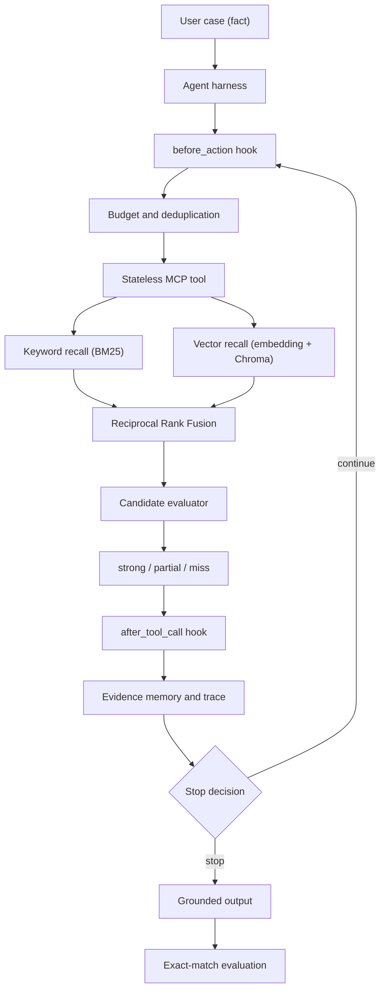

<div align="center">

# ⚖️ MCP Legal Agent

**A controllable legal-retrieval agent: stateless MCP tools, budgeted search, and evidence-grounded answers.**

[](https://www.python.org/)
[](https://fastapi.tiangolo.com/)
[](https://modelcontextprotocol.io/)
[](LICENSE)
[](tests/test_core.py)

*runs fully offline by default — no model download, no API key, no network*

</div>

---

## ✨ Overview

**MCP Legal Agent** links a case description (*fact*) to the statutes that plausibly apply, and refuses to answer when the evidence is insufficient. Every retrieved statute is **verified against the original fact** before it can appear in the output, so the tool never invents an article that was not retrieved and validated.

The agent is built for **auditable control**, not open-ended generation. Instead of letting a language model freely cite law, the system:

- retrieves candidates through **hybrid search** (BM25 + vector recall, fused with RRF);
- **verifies** each candidate against the raw fact and labels it `strong` / `partial` / `miss`;
- keeps only validated IDs in the final answer, with the evidence attached;
- records every decision in a **trace** (query plan, budget checks, tool results, evidence updates, stop reason).

> 🔑 **Core idea** — the model plans the *search*; the retrieval-and-verification tool decides *what is true*. A statute is only reported when it survives verification, and the agent explicitly abstains otherwise.

The same tool is exposed two ways: a **direct local call** (same function, in-process) and a **real MCP stdio** server/client pair. The transport is a configuration switch, not a different code path in the agent.

## 🏗️ Architecture



**Data flow.** A case `fact` enters the **AgentHarness**, which asks the planner for one or more search queries. Each query passes through the **`before_action`** hook, which rejects empty or duplicate queries and decrements a hard search budget. Allowed queries call the **stateless tool**, which performs **BM25** and **vector** recall, fuses the two rankings with **RRF**, and runs the **candidate evaluator**. Surviving evidence is promoted into memory by the **`after_tool_call`** hook (an evidence grade can only move *up*, never down). The loop stops as soon as a `strong` hit appears or the queries/budget run out, and the final answer lists only validated article IDs.

## 🚀 Key Features

- 🧱 **Controllable agent loop** — two explicit hooks (`before_action`, `after_tool_call`) wrap every tool call; policies live in the harness, not scattered in prompts.
- 💰 **Hard search budget** — `MAX_SEARCHES` caps tool calls, and **failed calls still consume budget** so retries cannot bypass the limit.
- 🚫 **Abstention by default** — with no verified evidence the agent returns “insufficient evidence” instead of guessing an article.
- 🔀 **Hybrid retrieval** — BM25 (lexical) and vector similarity (semantic) are combined by **Reciprocal Rank Fusion**.
- ✅ **Grounded verification** — candidates are judged against the **original fact**, never against the expanded query, so query expansion cannot invent facts.
- 🧠 **Monotonic evidence memory** — a candidate’s grade can only be upgraded (`miss → partial → strong`); it never regresses across tool calls.
- 🧵 **Per-request isolation** — each request gets a fresh state (memory, budget, trace); concurrent requests never share a budget.
- 🔌 **Two transports, one tool** — the tool is stateless and callable both `local` and over real **MCP stdio**.
- 🔍 **Full audit trace** — query planning, budget decisions, tool results, error types, evidence updates, and the stop reason are all recorded.

## 🧩 How It Works

### The `before_action` hook
Normalizes the query and rejects it when the tool budget is exhausted, the query is empty, or the query is a duplicate. It decrements the budget **before** the call so that a failing tool still counts against the limit — this is what makes the budget a real guard rail rather than a hint.

### The stateless tool
`retrieve_and_verify(query, fact, top_k)` retrieves candidates and verifies them. It holds **no session state**: the same function backs both the `local` path and the MCP `legal_search` tool. The vector backend is rebuilt per call, which keeps the tool stateless and makes it suitable for small, demonstrable corpora.

### The `after_tool_call` hook
Keeps only `strong`/`partial` evidence and enforces **monotonic** grading. The harness then decides whether to continue (another query) or stop (`strong_evidence`, `budget_exhausted`, or `queries_exhausted`).

### Grounded output
The final `articles` list contains **only** the IDs verified as `strong`. The response also includes the full `evidence`, the number of `searches`, the `stop_reason`, and the `trace`.

## 🧰 Tech Stack

| Component | Default (offline) mode | Real mode |
|---|---|---|
| Language / HTTP | Python 3.10+ (3.12 recommended), FastAPI, Pydantic, Uvicorn | same |
| MCP | direct in-process call | official SDK 1.x over **stdio** |
| Keyword retrieval | `rank-bm25`, or a built-in BM25 fallback | `rank-bm25` |
| Vector retrieval | deterministic hashed vector (not a semantic model) | DashScope `text-embedding-v3` + in-memory Chroma |
| Planner / evaluator | keyword-group rules | DashScope Qwen (OpenAI-compatible) |
| Evaluation | clearly labeled **simulated** report | exact-match over a CAIL-format JSONL set |

When an API timeout, a missing key, an unavailable embedding/Chroma backend, or invalid model JSON occurs, the system falls back to a **Mock** that is explicitly marked in the response. Malformed real-corpus configuration raises an error instead of silently masking missing data.

## 📁 Project Structure

```text
mcp-legal-agent/
├── agent/
│   ├── harness.py          # hooks, search budget, evidence memory, trace
│   ├── mcp_tool.py         # stateless tool + MCP server and stdio client
│   ├── retriever.py        # multi-route hybrid retrieval
│   └── evaluator.py        # candidate verification
├── data/
│   ├── laws.json           # teaching summaries of statutes
│   └── cail_mock.jsonl     # synthetic CAIL-format samples
├── evaluation/
│   ├── evaluate.py         # exact-match evaluation script
│   └── simulated_results.json
├── tests/
│   └── test_core.py        # functional tests
├── config.py               # environment-driven settings
├── common.py               # BM25, RRF, hashed vectors, DashScope client
├── main.py                 # FastAPI entry point
├── demo.py                 # standard-library offline demo
├── docs/
│   ├── architecture.mmd    # Mermaid architecture
│   └── VALIDATION.md       # functional verification record
├── scripts/
│   └── start.ps1           # Windows launcher
├── requirements.txt        # base service dependencies
├── requirements-full.txt   # real vector-retrieval dependencies
└── pyproject.toml          # ruff configuration
```

## 📦 Installation

Requires **Python 3.10+** (3.12 recommended).

```bash
python -m venv .venv
# Windows
.venv\Scripts\python.exe -m pip install -r requirements.txt
# POSIX
.venv/bin/python -m pip install -r requirements.txt
```

Optional real vector retrieval (adds Chroma):

```bash
pip install -r requirements-full.txt
```

## ⚡ Quick Start

Run the dependency-free demo first:

```bash
python demo.py
```

Start the HTTP service:

```bash
cp .env.example .env            # Windows: Copy-Item .env.example .env
python -m uvicorn main:app --host 127.0.0.1 --port 8001
# or, on Windows:
./scripts/start.ps1
```

Interactive docs: <http://127.0.0.1:8001/docs>

## 🔌 API Reference

| Method | Path | Body | Description |
|---|---|---|---|
| `GET` | `/health` | – | status, mock flag, active transport |
| `POST` | `/analyze` | `{"fact": "..."}` | run the agent over one case |

```bash
curl -X POST http://127.0.0.1:8001/analyze \
  -H "Content-Type: application/json" \
  -d '{"fact": "Zhang secretly stole property belonging to another person involving a large amount."}'
```

The response contains `articles`, `evidence`, `searches`, `stop_reason`, and `trace`.

## 🧪 MCP Mode

To exercise the **real MCP stdio** transport, set `TOOL_TRANSPORT=stdio` in `.env` and restart the service. The harness will launch `python -m agent.mcp_tool` as a subprocess, perform the MCP handshake, and call the `legal_search` tool over the protocol.

You can also run the server standalone so an external MCP client can connect:

```bash
python -m agent.mcp_tool
```

> stdio servers must never write logs to standard output — the pipe carries protocol messages.

## 🤖 Real Model Mode

Install the full requirements, then configure `.env`:

```bash
MOCK_MODE=false
DASHSCOPE_API_KEY=sk-...
DASHSCOPE_BASE_URL=https://dashscope.aliyuncs.com/compatible-mode/v1
```

- **Planner / evaluator** — `QWEN_MODEL` (default `qwen-plus`) plans queries and verifies candidates.
- **Embeddings** — `EMBEDDING_MODEL` (default `text-embedding-v3`) with an in-memory Chroma index.
- **Corpus** — `LAW_CORPUS` points to a JSON file of articles. Each entry needs a string `id`, `title`, and `text`; `keyword_groups` drives the rule-based Mock.

Invalid model JSON, empty responses, and backend errors are all caught and reported with a `mock:*` backend tag rather than being presented as real output.

## ⚙️ Configuration

| Variable | Default | Meaning |
|---|---|---|
| `MOCK_MODE` | `true` | fully offline; no calls leave the machine |
| `DASHSCOPE_API_KEY` | *(empty)* | enables real Qwen/embedding calls |
| `DASHSCOPE_BASE_URL` | DashScope compatible endpoint | override by region |
| `QWEN_MODEL` | `qwen-plus` | planner / evaluator model |
| `EMBEDDING_MODEL` | `text-embedding-v3` | embedding model |
| `MAX_SEARCHES` | `3` | hard tool-call budget (1–10) |
| `TOP_K` | `5` | candidates per retrieval (1–20) |
| `TOOL_TRANSPORT` | `local` | `local` or `stdio` |
| `LAW_CORPUS` | `data/laws.json` | path to the article corpus |


## 📝 Citation

If you use this project in academic work, please cite it as described in [CITATION.cff](CITATION.cff):

```bibtex
@software{mcplegalagent2026,
  title  = {MCP Legal Agent: A Controllable Legal-Retrieval Agent with Stateless MCP Tools},
  author = {MCP Legal Agent contributors},
  year   = {2026},
  url    = {https://github.com/<you>/mcp-legal-agent}
}
```

## 🙏 Acknowledgments

- [Model Context Protocol](https://modelcontextprotocol.io/) and the [MCP Python SDK](https://github.com/modelcontextprotocol/python-sdk)
- [rank-bm25](https://github.com/dorianbrown/rank_bm25) for lexical scoring
- [Chroma](https://www.trychroma.com/) for the optional local vector store